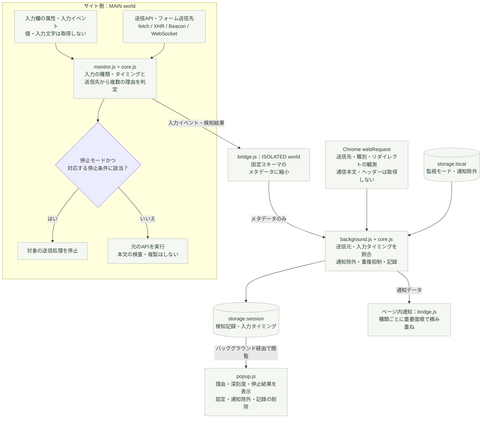

# Input Defender

入力内容を読まず、サイトのフォームと通信の**挙動**から、不審な動きを警告するChrome拡張です。Manifest V3、Chrome 119以上。開発版 v0.1.1。

**入力値の取得・保持・照合・外部転送は行いません。** 実際の漏えいやサイトの悪意を断定する製品ではありません。

## インストール

1. Chromeで `chrome://extensions` を開く。
2. 「デベロッパーモード」を有効にする。
3. 「パッケージ化されていない拡張機能を読み込む」から、このフォルダ内の **`extension`** を選ぶ。
4. 監視したいページを再読み込みする。拡張をツールバーに固定すると検知数を確認しやすくなります。

ビルドや依存関係のインストールは不要です。[GitHub Releases](https://github.com/Irris7z/input-defender/releases) の拡張用ZIPを展開し、`manifest.json` が入ったフォルダを選ぶことでも導入できます。Chrome Web Storeには公開していません。

## 検知する挙動

| 挙動 | 検知の根拠 | 注意 |
| --- | --- | --- |
| 個人情報用フォームが別オリジンへ送信 | 入力欄の `type` / `autocomplete` / `name` / `id` と送信先 | 正規の決済やサービス連携も該当 |
| フォーム送信先の変更 | 最初に観測した `action` / `formaction` と現在の送信先の比較 | 正規の動的フォームも該当 |
| 入力直後の外部送信API呼び出し | 個人情報用の欄の信頼された `input` / `change` イベントから5秒以内 | 同時発生の推定であり、入力内容を送った証拠ではない |
| 入力直後の画像・Worker等の外部リクエスト | ブラウザの `webRequest` が通知する送信先と入力タイミング | 本文を取得せず観測のみ |
| 入力直後の外部リダイレクト | 通信のリダイレクト先オリジン | 本文を取得せず観測のみ |
| 暗号化されない送信先 | 個人情報用フォームのHTTP送信先、または入力直後のHTTP通信 | 同一オリジンでも警告 |

氏名、住所、カード関連、メール、電話番号、パスワードの**欄の種類**を属性から推定します。その欄に何が入力されているか、空欄かどうかは確認しません。HTTPの通常フォームは空欄でも警告されます。

`fetch`、XHR、Beacon、WebSocket、フォームの送信をページ側で監視します。HTTP(S)の各フレームが対象です。WebSocketはHTTP(S)とのプロトコル差だけでは別オリジンとみなさず、ホスト・ポートを比較します。サブドメインや別ポートは別オリジンとして扱います。

## ロジックの構成図

ページ側の送信前監視と、Chrome側の通信観測を組み合わせます。図の矢印で渡すのは、欄の種類・操作タイミング・送信先・検知理由などのメタデータだけです。



| 深刻度 | 表示色 | 判定する挙動 |
| --- | --- | --- |
| FATAL | 紫 | フォームの送信先が最初に観測した送信先から変わった |
| CRITICAL | 赤 | 入力直後の外部送信・通信・リダイレクト |
| WARNING | 黄 | HTTPの送信先、フォームの外部送信先 |

深刻度は挙動からの推定です。FATALでも漏えいや悪意が確認できたという意味にはなりません。HTTPと自動送信の疑いなどが重なれば、どれか一つに絞らず、すべての理由を表示します。

**停止できるのはページ側で監視できた送信処理だけ**です。`webRequest` は送信先などの観測に使い、本文を見たり、そこから通信を遮断したりはしません。通知除外は元ページと送信先のオリジンの完全一致で適用します。深刻度の名前だけで停止を決めず、既存の停止条件と監視モードで判定します。

設定の変更は `background.js → bridge.js → monitor.js` の順に反映します。図では検知の流れを追いやすくするため、この逆向きの設定経路は省略しています。未知のメッセージ項目やURLのパス・クエリは拡張内への受け渡し時に除外し、メモリ内の検知記録は最大100件／タブです。

## 操作

- 初期設定は **検知のみ**。通信は止めず、拡張アイコンのバッジ、ポップアップ、ページ右下の通知で確認できます。
- 一度の動きで複数の理由が該当した場合は、すべて表示します。HTTP通信でも「入力直後の外部送信」「フォーム送信先の変更」を隠しません。
- ページ内通知は種類ごとに積み重ね、上から **FATAL（紫）→ CRITICAL（赤）→ WARNING（黄）** の順に並べます。同じ種類・元ページ・送信先の繰り返しは通知受信回数としてまとめます。個別または一括で閉じても、監視と検知記録は残ります。最大20件を表示し、省略があれば件数を示します。
- **WARNING**: HTTP通信・フォームの外部送信先。**CRITICAL**: 入力直後の外部送信・通信・転送。**FATAL**: フォーム送信先の変更。すべて挙動に基づく推定であり、FATALも漏えい・改ざん・悪意の確定を意味しません。複数の理由を持つ記録の深刻度は最も高い理由に合わせます。
- 任意で **要注意の送信を停止** に切り替えられます。対象はフックできたAPI呼び出しやフォーム送信です。構造の検知や `webRequest` による通信観測は停止できません。住所補完・決済・ログインなどが動かなくなることがあります。
- 通知除外は「元フレームのオリジン → 送信先のオリジン」の完全一致で設定します。除外すると停止も解除されます。確認操作後に追加され、いつでも削除できます。停止した操作を自動で再送しません。
- 「記録を削除…」から対象と影響を確認し、「記録だけを削除」でタブの記録を削除できます。既存記録は除外設定を追加しても残ります。
- 上部に監視状態と監視モード、中央に記録、下部に「検知記録」「通知除外」「プライバシー」の切り替えを固定しています。記録は「すべて」「CRITICAL以上」「FATALのみ」「停止した操作のみ」で絞り込めます。

## プライバシー設計

詳細は [PRIVACY.md](PRIVACY.md)。重要な制約を実装とテストの両方で守ります。

- 入力欄の `.value`、テキスト、キー入力内容を取得しない。
- 通信本文、FormData、Cookie、通信ヘッダーを取得しない。`webRequest` の `requestBody` も要求しない。
- ページの通信引数は中身を調べず、元のAPIにそのまま渡す。拡張が別の送信を作成したり、リクエストを複製したりしない。
- URLから利用するのはスキーム・ホスト・ポートのみ。パス、クエリ、フラグメント、認証情報を記録・転送しない。
- 入力イベントから保持するのは「欄の種類」と「発生時刻」のみ。
- 検知記録は `chrome.storage.session`（ブラウザのメモリ）に最大100件/タブ。ページの再読込・タブを閉じる・ブラウザ終了で消去。設定と通知除外は `chrome.storage.local` に保存。
- 外部サービス、分析SDK、テレメトリー、同期ストレージ、リモートコードを使わない。拡張ページのCSPでも外部接続を禁止。
- ページからのメッセージは列挙型・オリジン・真偽値だけの固定スキーマに縮小。設定変更・記録閲覧は拡張自身のポップアップからのみ受け付ける。

「外部送信なし」は拡張が取得したデータを外部サービスに送らないという意味です。検知のみモードでは、サイト自身の通信は通常通り実行されます。Chrome自体のアップデート等の通信は本拡張の対象外です。

## 限界

- **同一オリジンのHTTPS送信**、5秒より遅い送信、属性から識別できない欄、通常の入力イベントがないプログラム更新などは見逃すことがあります。
- 通信本文を参照しないので、暗号化・符号化の有無や、カード番号を実際に送ったかは判断できません。
- MAIN worldのAPI監視とページ内通知は、ページのコードに上書き・妨害・偽装される可能性があります。ページとのメッセージ橋渡しも真正性の証明にはなりません。拡張の警告は改ざん検知の確証として扱わないでください。
- ブラウザ側の `webRequest` 観測はページ側のAPI上書きでは無効化されませんが、入力タイミングとの対応が必要であり、監視権限やChromeのAPI範囲にも制約があります。Worker等のフレーム対応が取れない通信は検知できない場合があります。
- 通常のManifest V3拡張は `webRequestBlocking` を利用できません。APIフックを回避する通信を確実に遮断する仕組みではありません。
- `chrome://`、Chrome Web Storeなどの保護されたページ、HTTP(S)以外、権限がないページは監視しません。`about:blank` / `srcdoc` / 不透明オリジンのフレーム、閉じたShadow DOM内の欄も完全には扱えません。
- 読み込み直後や設定反映までの短い時間は検知のみで動作します。API経路や呼び出し順による競合は完全には排除できません。
- 送信操作直後の正規のAPI通信は約1.5秒間、入力直後という理由だけでは警告しません。HTTPなど別の理由は引き続き警告します。

## ローカル動作確認

```sh
npm run demo
```

`http://127.0.0.1:4173` をChromeで開き、拡張を有効にして試せます。受信先は同じ端末の別ポート `4174` です。外部APIは使わず、受信データを保存・ログ出力せず破棄します。本物の個人情報は入力せず、ダミーだけを使ってください。デモ操作は固定文字列のみを送信します。通常のフォーム送信ボタンだけはブラウザ標準のフォーム送信を行います。

実際に入力値を読み取って送る危険な挙動を再現する場合は、**`http://127.0.0.1:4173/attack-lab.html`** を開きます。入力中の自動送信、通信手段別の送信、画像URLへの埋め込み、フォーム送信先の改ざんを試せます。送信は端末内に限定します。このHTMLのテストコードだけが入力値を読み取ります。手順と期待する結果は [ローカルテストの説明](fixtures/ATTACK_LAB.md) を参照してください。

## 開発・検証

Node.js 22以上。拡張本体に実行時依存関係はありません。

```sh
npm ci
npm run build
npm test
npx playwright install chromium
npm run test:browser
npm run package
```

単体テストでは検知ルール、オリジンへの縮小、許可の範囲、メッセージの削減、および本文に触れると例外になるオブジェクトを使った透過転送を検証します。ブラウザテストは独立したテスト用プロファイルへ拡張を実際に読み込み、警告、停止、通知除外、UI、記録に入力値・本文・URLクエリが残らないことを検証します。日常利用しているChromeのプロファイルは使いません。

`main-world.js` と `isolated-world.js` は `core.js` と各エントリから生成した、実行環境ごとの独立したファイルです。配布物に同梱しているため、利用者のビルドは不要です。ソースを変更した場合は `npm run build` の後、拡張の再読み込みと監視ページの再読み込みを行ってください。テスト・パッケージ作成時には自動で再生成します。

## 既存製品

2026年11月4日時点で、類似製品は存在します。詳細と今回の設計との違いは [RESEARCH.md](RESEARCH.md)。

## リリース

`main` へのpushでGitHub Actionsが単体・プライバシー・ブラウザテストを実行し、すべて成功した場合だけ、拡張のバージョンに対応したリリースを作成します。配布物は拡張用ZIPとSHA-256チェックサムです。

次のリリースでは `extension/manifest.json`、`package.json`、`package-lock.json` のバージョンを揃え、`docs/releases/v<version>.md` にリリース内容を記載します。既存のリリースとタグは上書きしません。手動の再実行はActionsの「Validate and release」から行えます。

## Chromeの公式仕様

- [Content scripts / 実行環境とMAIN worldの注意点](https://developer.chrome.com/docs/extensions/develop/concepts/content-scripts)
- [Manifest / document_start、all_frames、world](https://developer.chrome.com/docs/extensions/reference/manifest/content-scripts)
- [webRequest / MV3の遮断制約と観測範囲](https://developer.chrome.com/docs/extensions/reference/api/webRequest)
- [storage / session、setAccessLevel](https://developer.chrome.com/docs/extensions/reference/api/storage)
